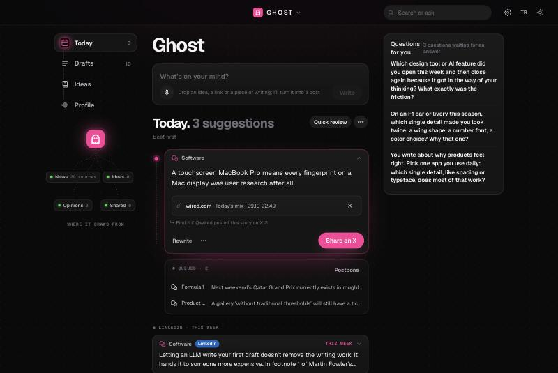

# Ghost

**A ghostwriter for X that reads before it writes, learns your voice, and never posts for you.**

Every morning Ghost reads the publications you care about, finds the one detail in a story that is actually worth saying something
about, and drafts a post in your voice. You edit, post, or throw it away. Every edit and every "no" teaches it a little more about how
you write and what you find worth saying.

It runs on your Mac. It writes with Claude through your own Claude subscription. It never touches your X account.



## Who it's for

People who have something to say but not the time to watch the news all day and turn it into posts: designers, engineers, founders,
researchers, writers, analysts, fans of a sport or a scene. If you want to post a few good things a day, in your own words, about the
things you know, Ghost is built for you. If you want a content machine that floods your timeline, it isn't.

## Why it doesn't sound like AI

Most AI writing tools summarise the news and add an opinion. That's what makes their posts feel interchangeable. Ghost works the other
way round:

- **It reads the whole article, not the headline,** and looks for a concrete detail (a name, a number, a decision, a word choice) that the
  post can stand on. No detail, no post.
- **It writes down the obvious take first, then refuses to use it.** Every candidate angle is checked against "what would everyone say
  about this?" before a word is written.
- **It learns from examples of your real posts,** not from a style description. Your length, your openings, your kind of humour.
- **It checks itself before you see anything:** every claim is compared with the source, a separate "cold reader" judges whether the post
  makes sense on its own and whether a good writer would actually post it. Drafts that fail are rewritten or dropped. Fewer, better.
- **It doesn't invent your life.** No made-up "I tried this yesterday", no fake experience, no numbers that aren't in the source.
- **It knows when it's repeating itself,** across days, and across what the accounts you follow already said.

## A day with Ghost

1. **Morning.** Ghost has read your sources and lined up today's drafts, strongest first. Each one shows where it came from and why it
   was picked.
2. **Two minutes.** Go through them: keep, edit, post, or remove with a reason ("not my topic", "the take is obvious", "not my voice",
   "wrong facts"). A keyboard-driven quick review makes this fast.
3. **Anytime.** Paste a link (article, YouTube video, podcast, an X post), a half-formed idea or a voice note. Ghost decides whether it's
   worth quoting, turning into your own post, or skipping, and gives you the finished text.
4. **It adapts.** If you stop looking, it writes less. If you edit a lot, it learns the pattern and stops making the same mistake.

## Your advisor

Ghost also plays the role of a communication advisor. Before it writes anything for you, three experts (a strategist, an editor, an X expert)
ask you eight short questions: what the account is for, who you write for, what sets your view apart, how often and when you post, how
sharp you want to be. Your answers shape every topic and every draft from then on. Then, in the **Advisor** tab:

- **Where your account stands:** six scores measured from your real data, not guessed: rhythm, range of topics, depth (sourced and
  grounded in your own views), voice (how much you had to rewrite), reader response (saves and shares per thousand views) and consistency
  with the opinions you hold. Each one says what the number is based on, what is missing and the one thing to do about it. When there is
  not enough data, it says so instead of inventing a score.
- **This week:** a short note from your advisor every Monday (what the account really needs this week, three gaps with one action each, a
  day-by-day plan of what to post, why, and where) and one thing not to do.
- **Coming up:** dated events in your topics over the next three weeks (award shortlists, launches, conferences, finals, anniversaries),
  found by searching the web. Ghost reminds you a few days before and "Prepare" turns an event into a draft idea written in your voice.

## What's inside

- **Daily drafts for X** in several shapes: a one-liner, an observation, a longer take, a thread. A balanced mix across your topics.
- **Quote and reply suggestions:** finds the publisher's own post or a post you opened so you can quote it instead of posting a bare link.
- **Turn anything into a post:** articles, videos and podcasts (transcribed on your Mac with Whisper), X posts, ideas, voice notes.
- **LinkedIn posts** and **blog topic suggestions** when you want something longer.
- **Story of the week:** a sourced thread about the story behind something in your field.
- **Your notebook:** ideas you jotted down, opinions you hold (so new posts stay consistent with what you said before), questions Ghost
  asks you to get your real take.
- **Learning:** edits, rewrite requests ("shorter", "less polished", "I'd never say that") and removal reasons become lessons you can see
  and delete in Profile.
- **Weekly self-review:** Ghost measures what you kept and what you threw away and tunes itself (within limits you can undo).
- **Chrome extension (optional, read-only):** reads your own posts and their numbers on your X profile, your bookmarks, your lists and the
  posts you open. It never clicks, likes, follows or posts.

## Make it yours

Nothing about the writer is built in. The first time you open Ghost you set it up in about two minutes:

- your **X username** and the **language you write in** (English, Türkçe, Deutsch, Español, Français, Italiano, Português, Nederlands),
- **who you are** in a sentence or two,
- the **topics** you want to write about, from suggestions or your own ("natural wine", "Formula 1", "type design"...),
- **10–30 of your own posts** as examples (or let the extension read them from your profile),
- topics you **don't** want to touch.

From this Ghost writes your voice profile and picks 5–8 publications for each topic: real RSS feeds where it knows them, Google News
searches otherwise. Every feed is tested; broken ones are dropped. Later, in **Profile → Topics and sources**, you can add a topic (Ghost
suggests sources for it), remove one, or add any RSS feed or search you like.

Advanced options live in `ayarlar.json` (created from `ayarlar.ornek.json`):

| Setting | What it does |
| --- | --- |
| `kendi_depolar` | Paths to your own git repositories. Ghost can then suggest posts about what you're actually building, based only on your commits. |
| `abonelikler` | Domains you subscribe to (e.g. `adweek.com`); paywalled articles are read with your Chrome session cookies, kept in memory only. |
| `bultenler`, `bulten_kutulari`, `bulten_gonderenler` | Read newsletters from the Mail app (read-only) and use the stories they mention as sources. |
| `ghost_konu_toplantisi` | Before writing, Ghost asks you one question per topic so the post is built on your answer. |
| `ghost_kesif`, `ghost_tempo` | Daily discovery on/off; write less automatically when you aren't using Ghost. |

## Install

Requirements: a Mac with Apple silicon, macOS 14 or newer, [Homebrew](https://brew.sh), Git, and **Claude Code signed in with your Claude
subscription** (Ghost does its writing through it, so there is no separate API bill).

```bash
git clone https://github.com/yehsohimself/ghost.git
cd ghost
./kurulum.sh
```

The script installs `ffmpeg`, `deno` and `uv`, creates a Python environment and starts Ghost at login. Then open
http://127.0.0.1:8767 (later: double-click `Ghost.command`) and set up your voice.

If Claude Code isn't installed yet:

```bash
curl -fsSL https://claude.ai/install.sh | bash
claude auth login
```

**Chrome extension (optional):** open `chrome://extensions`, turn on *Developer mode*, choose *Load unpacked* and select the `uzanti`
folder. Then open your X profile once.

Discovery runs every day at 07:30 and 14:00, or whenever you press **Refresh**. A run makes a few dozen Claude requests; Ghost slows down
on its own when you aren't looking at it.

## Privacy

- Everything (your profile, drafts, notes, the posts the extension reads) stays in this folder on your Mac.
- Text goes to Claude only through your own Claude Code login. Article pages are fetched directly from the publisher.
- The extension only talks to `127.0.0.1`. It reads what is on your screen; it has no permission to act on X.
- Ghost never posts. "Post on X" opens X's own compose window with the text filled in; you press the button.

## Notes

- The code uses Turkish identifiers and comments (it started as a personal tool in Turkish). The interface is available in English and
  Turkish; the writing language is whatever you choose at setup.
- Tests: `.venv/bin/python -m pytest tests -q`; quick check: `.venv/bin/python duman_testi.py hizli`.
- Sister projects: [Studio](https://github.com/yehsohimself/studio) (video to transcript, subtitles, clips) and
  [PT](https://github.com/yehsohimself/pt) (personal trainer and nutrition coach).

MIT License.

---

**Türkçe:** Ghost, ilgilendiğiniz yayınları her gün okuyup paylaşmaya değer bir ayrıntı bulan ve sizin sesinizle X gönderisi taslağı yazan,
bilgisayarınızda çalışan bir yazı asistanı. Bariz yorumu yazmaz, kaynağa göre kendini denetler, düzelttikçe öğrenir ve hiçbir şeyi sizin
yerinize paylaşmaz. İlk açılışta kullanıcı adınızı, yazı dilinizi, konularınızı ve kendi gönderilerinizden örnekleri verirsiniz; tarzınızı ve
her konu için okunacak kaynakları Ghost kurar. Kurulum: `./kurulum.sh`, sonra http://127.0.0.1:8767. Claude Code'un Claude aboneliğinizle
giriş yapmış olması gerekir.
